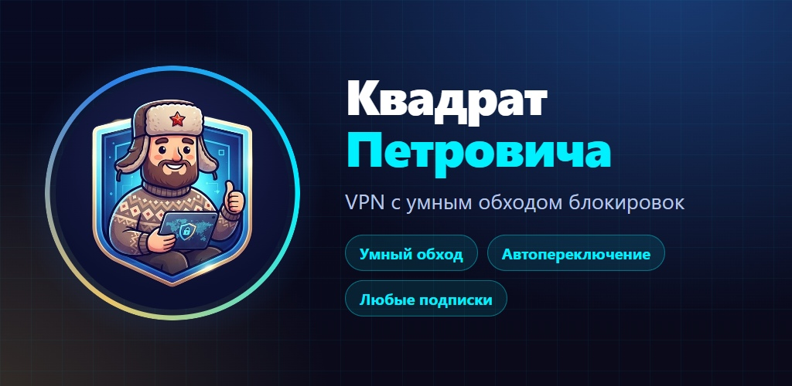
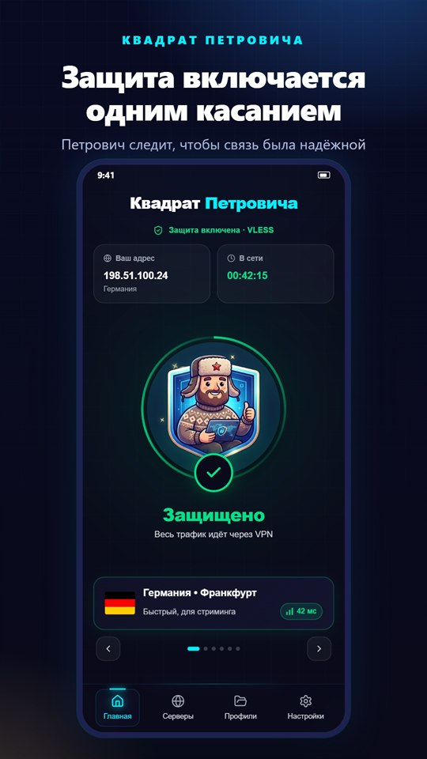
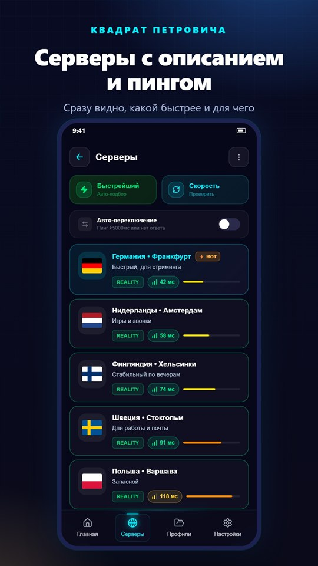
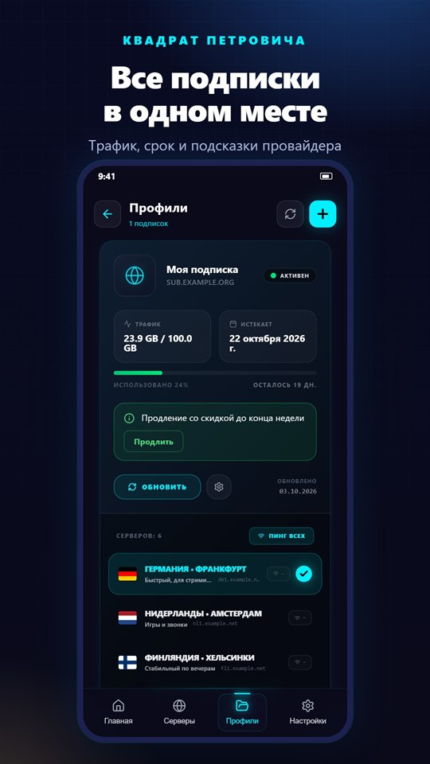
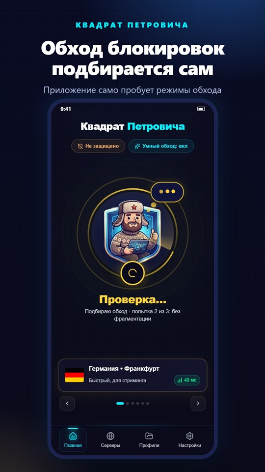
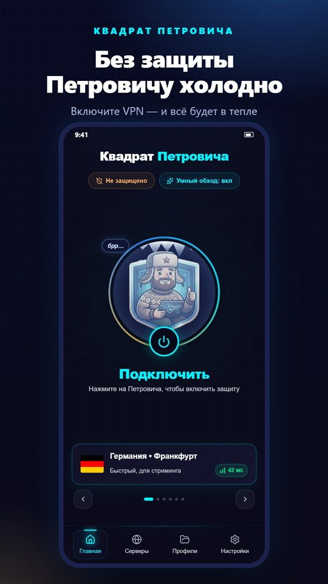

<div align="center">


# Квадрат Петровича

**VPN-клиент с умным обходом блокировок для Android и Windows**  
Обходит DPI и белые списки — там, где другие клиенты не работают

<br/>

[](https://github.com/sim-proxy-online/vpn_app/releases/download/v3.0.70/Petrovich-3.0.24-106.apk)
[](https://github.com/sim-proxy-online/vpn_app/releases/download/v3.0.70/KvadratPetrovicha-TUN-Setup-3.0.70.exe)
[](https://github.com/sim-proxy-online/vpn_app/releases/download/v3.0.4/KvadratPetrovicha-3.0.4-portable.exe)

<br/>



</div>

---

## Скриншоты

<table>
  <tr>
    <td align="center"></td>
    <td align="center"></td>
    <td align="center"></td>
    <td align="center"></td>
    <td align="center"></td>
  </tr>
  <tr>
    <td align="center"><sub>Защита<br/>одним касанием</sub></td>
    <td align="center"><sub>Серверы с описанием<br/>и пингом</sub></td>
    <td align="center"><sub>Все подписки<br/>в одном месте</sub></td>
    <td align="center"><sub>Обход подбирается<br/>сам</sub></td>
    <td align="center"><sub>Без защиты<br/>Петровичу холодно</sub></td>
  </tr>
</table>

---

## О приложении

**Квадрат Петровича** — клиент на базе [Xray-core](https://github.com/XTLS/Xray-core) и [mihomo](https://github.com/MetaCubeX/mihomo) с поддержкой 17+ протоколов. Специально оптимизирован для работы в России и других странах с жёстким DPI: фрагментация TLS ClientHello, шумовой трафик и умная система пресетов позволяют подключаться там, где обычные клиенты показывают -1.

Приложение работает с подписками **любых провайдеров**, а не только с нашей. Получить подписку: [petrovich.party](https://petrovich.party). Страница приложения со скачиванием и ответами на вопросы: [app.petrovich.party](https://app.petrovich.party).

---

## Возможности

### Протоколы
VLESS · VMess · Trojan · Shadowsocks · Hysteria2 · TUIC · WireGuard · REALITY · ShadowTLS · AnyTLS · SOCKS · HTTP · SSH · Brook · Naive · XHTTPv2

### Подписки и серверы
- Импорт по ссылке, QR-коду (камера + галерея), из буфера обмена, из файла `.txt/.json/.yaml`
- Массовая вставка списка серверов
- Deep link `sim://` и `happ://` — открывается прямо из браузера
- **Автоопределение панелей:** Remnawave, Marzban/Marzneshin, 3x-ui, Hiddify
- Авто-обновление подписок по расписанию
- Отображение трафика, даты истечения и статуса подписки
- **Описание сервера** под названием, цветная таблетка пинга («42 мс»), большой флаг страны

### Совместимость с Happ
Приложение понимает [параметры управления Happ](https://www.happ.su/main/ru/dev-docs/app-management), которые провайдер отдаёт вместе с подпиской:
- описание сервера, фирменный цвет профиля, порядок и закрепление профилей, свёрнутые/развёрнутые списки;
- автоподключение к нужному серверу, обновление и пинг при открытии, предупреждения об окончании подписки;
- раздельное туннелирование по приложениям, исключение маршрутов, свой User-Agent, скрытие настроек.

Параметры применяются только для проверенных провайдеров и подписок, которые вы подтвердили сами. Небезопасные параметры (свои туннельные конфиги, учётные данные прокси) не применяются никогда.

### Обход блокировок
- **Автоподбор обхода** — приложение само пробует режимы обхода, пока не найдёт рабочий
- **Авто-пресет по оператору** — определяет МТС / Мегафон / Теле2 / Ростелеком / Билайн и применяет нужные настройки DPI автоматически при запуске
- **Фрагментация TLS** — разбивает ClientHello на части, обходя DPI и белые списки
- **Шумовой трафик (Noises)** — дополнительная обфускация соединения
- Пресеты: `МТС · Мегафон · Теле2` / `Ростелеком · Дом.ру` / `YouTube / Instagram` / `Максимум`

### Подключение и маршрутизация
- **Авто-выбор лучшего сервера** — пинг всех узлов и подключение к быстрейшему
- **Умная маршрутизация:** Глобально · Обход RU · Только заблокированное · Обход локальных
- **Split-tunnel по приложениям** — выбираешь какие приложения идут через VPN
- Прямой доступ к российским банкам и сервисам (Госуслуги, Сбер, Тинькофф, ВТБ и др.)
- Пользовательские правила маршрутизации (домены, IP, geoIP)
- Блокировка рекламы

### Стабильность
- **Авто-реконнект** при смене сети (Wi-Fi ↔ мобильная)
- **Kill Switch** — блокирует трафик при обрыве VPN
- Watchdog — обнаруживает зависание трафика и переподключается
- **Авто-переключение** на другой сервер при деградации

### Безопасность и диагностика
- Плитка **«Ваш адрес»** — реальный внешний IP и страна при включённом VPN
- Авто-тест IP и DNS-утечек при подключении
- Speed Test — замер реальной скорости через сервер
- Мониторинг качества соединения (задержка, потери, jitter)
- **DoH / Fake DNS** — защита DNS-запросов
- Хосты-маппинг, выбор первичного/резервного DNS

### Интерфейс
- Тёмный неоновый UI с выбором цвета акцента
- **Петрович меняет настроение** по состоянию подключения, на пустых экранах — рисунки
- Dashboard: графики трафика, история, карта серверов
- Виджет скорости ↑/↓ в шторке уведомлений (Android)
- Русский и английский интерфейс
- Онбординг для новых пользователей

### Данные и экспорт
- Резервная копия всех профилей и настроек одним файлом
- Опциональное шифрование бэкапа (AES-256)
- **Авто-обновление приложения** через GitHub Releases

---

## Что изменилось после v3.0.4

- **Android 3.0.24, сборка 106** — новая главная и управление VPN из шторки, улучшения переподключения.
- **Windows TUN 3.0.70** — служба Wintun, режимы подключения, Kill Switch и новая панель серверов на главной.

[Полный список изменений](https://github.com/sim-proxy-online/vpn_app/releases/tag/v3.0.70).

## Что нового в 3.0.4

- **Не падает при отключении VPN** — в 2.9.0 и 2.9.1 Android мог закрыть приложение при остановке туннеля.
- **Меньше расход батареи** — главный экран с включённым VPN больше не перерисовывается непрерывно; анимации «Защищено» отыгрывают и замирают.
- **Выбор сервера при включённом VPN переключает туннель** — раньше менялась только отметка, а трафик шёл через прежний сервер.
- **Компактный список серверов** — на экране 9–10 серверов вместо пяти; порядок не прыгает во время замера скорости.
- **Заголовки разделов закреплены** — прокручивается только содержимое.
- **Интерфейс видит VPN, который ещё поднимается**, и не показывает ложные «VPN завис» и «утечка DNS».
- **Предупреждение о подписке по http** — ключи серверов по http идут открытым текстом.

## Что нового в 2.9.1

- **Kill Switch действительно блокирует трафик** — пока VPN поднят, обходной путь закрыт; добавлено файловое логирование.
- **Подписки обновляются в фоне** — даже когда приложение закрыто, конфигурации остаются свежими.
- **Петрович в кибер-броне** — новый образ маскота, пока VPN включён; белый фон у иконки лаунчера.
- **Полностью переведённый английский интерфейс** — ещё ~250 строк ушли в словарь.
- **Общая проверенная гео-база** — одинаковый geoip/geosite на всех платформах.
- **Исправления утечек и падений** — утечка реального IP и логов в logcat, ложное срабатывание DNS leak-теста, падение процесса при сбое прогона, аварийный выход на Android 7–12, OOM в release-сборке.
- **Безопасность Windows** — contextIsolation включён, ужесточена навигация, надёжнее повтор обновлений.
- **Исправлена portable-версия Windows** — сборка из `%TEMP%` (короткие 8.3-пути) не могла обратиться к мосту: пинги, подключение и обновление отвечали «forbidden», UI показывал «[object Object]». Установленная версия багом не была затронута.

Полный список версий и файлы — на странице [Releases](https://github.com/sim-proxy-online/vpn_app/releases).

---

## Установка

### Android
1. Скачайте [`Petrovich-3.0.24-106.apk`](https://github.com/sim-proxy-online/vpn_app/releases/download/v3.0.70/Petrovich-3.0.24-106.apk)
2. Откройте файл на устройстве → разрешите установку из неизвестных источников
3. Добавьте подписку (ссылка / QR / буфер обмена) и нажмите на Петровича

> Требования: Android 7.0+ (API 24), arm64 или arm32

### Windows
| Вариант | Ссылка | Описание |
|---|---|---|
| Установщик | [KvadratPetrovicha-TUN-Setup-3.0.70.exe](https://github.com/sim-proxy-online/vpn_app/releases/download/v3.0.70/KvadratPetrovicha-TUN-Setup-3.0.70.exe) | Для установки службы TUN нужны права администратора |
| Portable (архив) | [KvadratPetrovicha-3.0.4-portable.exe](https://github.com/sim-proxy-online/vpn_app/releases/download/v3.0.4/KvadratPetrovicha-3.0.4-portable.exe) | Запускается без установки |

> Требования: Windows 10+ x64

### Если у вас был Sim Proxy
«Квадрат Петровича» — **новое приложение**: оно ставится рядом со старым Sim Proxy, а не поверх него. Чтобы перенести подписки и настройки:
1. В старом Sim Proxy: **Настройки → резервная копия (экспорт)** — сохраните файл.
2. В «Квадрат Петровича»: **Настройки → «Восстановить из бэкапа»** — выберите этот файл.

Или просто добавьте подписку заново по ссылке.

Все версии и список изменений — на странице [Releases](https://github.com/sim-proxy-online/vpn_app/releases).

---

## Проверка подлинности

Скачанные файлы можно проверить — это защищает от подмены на стороне CDN/зеркала.

**1. Хеши SHA-256.** К каждому релизу прикреплён файл `SHA256SUMS.txt`:

```bash
sha256sum -c SHA256SUMS.txt          # Linux / macOS
Get-FileHash .\SimProxy-v2.7.1.apk -Algorithm SHA256   # Windows PowerShell
```

**2. Подпись APK.** APK подписан ключом проекта; отпечаток сертификата публикуется здесь:

```bash
apksigner verify --print-certs SimProxy-v2.7.1.apk
```

| Поле | Значение |
|---|---|
| Signer DN | `CN=Sim Proxy, OU=Development, O=SimProxy, C=RU` |
| **SHA-256 сертификата** | `c20f51e2f97fd01ddcb68a906b3bdcd3bd02b3ab83aeff23b1684238eeb704d1` |

Отпечаток в порядке (без пробелов и двоеточий, в нижнем регистре) — файл от нас. APK с любым другим отпечатком **не обновится поверх** установленного: Android сам отклонит такую установку — это штатная защита.

> Если отпечаток вдруг изменится (смена keystore), это будет объявлено отдельно в релизе.

**3. Подпись Windows-сборки.** Portable-`.exe` подписывается через SignPath (см. [SIGNPATH_SETUP.md](SIGNPATH_SETUP.md)):

```powershell
Get-AuthenticodeSignature .\SimProxy-2.7.1-portable.exe | Format-List Status, SignerCertificate
```

Статус `Valid` — подпись доверенная. Подпись набирает репутацию SmartScreen по числу загрузок, поэтому у свежего издателя Windows всё равно может показать предупреждение.

---

## Deep links

Открываются прямо из браузера (схемы `sim://` и `happ://`):

| Ссылка | Действие |
|---|---|
| `sim://import/<url>` | импорт подписки или сервера |
| `sim://add/<url>` · `sim://subscribe/<url>` | импорт подписки |
| `sim://routing/add/<base64>` | импорт профиля маршрутизации |

Протокольные ссылки `vless://` `vmess://` `trojan://` `ss://` `hysteria2://` `tuic://` `wireguard://` — вставляются из буфера обмена.

---

## Нижняя навигация: эталонный вид

Согласованный вид нижней зоны. Меняется только осознанно — иначе ломается то, что уже принято.

| Элемент | Как должно быть |
|---|---|
| Контейнер меню | Полностью прозрачный: никакой заливки во всю ширину и **никакого затемняющего градиента у нижнего края** (шлейф убирали специально). |
| Карточка меню | Плавающая скруглённая дорожка на `--nav-track`: в тёмной теме `#1a1a32` (тело пилюли сервера на «Главной»), в светлой `#ffffff`. Ровная заливка без отливов и переливов (бирюзовый/индиго-градиенты на короткой карточке читались цветными полосами и ушли), плюс светлая кромка сверху (`inset 0 1px 0 rgba(255,255,255,0.07)`). |
| Обводка | Лёгкая кромка 1dp на `--nav-outline`: тёмная тема `rgba(255,255,255,0.12)`, светлая `rgb(15 23 42 / 0.14)`. |
| Активный пункт | Акцентная «ручка»: `bg accent/10` + `border accent/30`, скользит анимацией `layoutId="mobNavKnob"`. |

Нижняя зона страниц (`App.tsx`, `page-wash`):

- **«Главная»** — как было: лист обрезается на 72px над меню, ниже ровный фон страницы.
- **Серверы / Профили / Настройки** — контент доходит до низа и уходит под меню, **без затемнения у края**. Списки имеют собственный нижний отступ (`pb-28`), чтобы последний элемент прокручивался выше меню.

Реализация: `src/components/BottomNav.tsx` (`MobileNav`), переменные в `src/index.css` (раздел `:root` / `[data-theme="light"]`), нижние отступы в `src/App.tsx` и в списках экранов.

---


## Конфиденциальность

Какие данные хранятся на устройстве и к каким сервисам обращается приложение — в [политике конфиденциальности](https://app.petrovich.party/privacy-policy.html).

---

## Дисклеймер

Приложение предназначено для законного использования: приватность, доступ к сервисам и обход цензуры там, где это разрешено. Подписку на прокси-серверы пользователь предоставляет самостоятельно.
